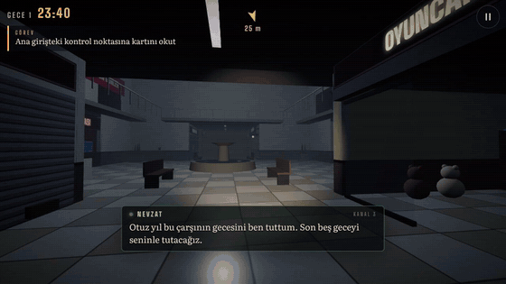
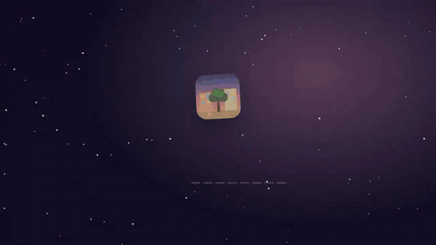
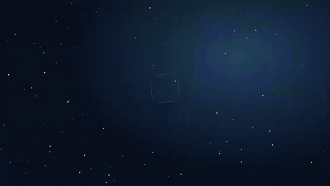

**Kışı seven bir geliştirici. Oyunlar, telefon uygulamaları, bir Minecraft modu ve küçük Windows araçları yapıyorum.** 
Hepsi Türk masallarından, kıştan ve Nardugan'dan ilham alıyor.

<!-- KIS:BASLA -->

🌅 Nardugan'a (kış gündönümü) **59 gün** kaldı &nbsp; `❄❄❄❄❄❄❄❄❄❄❄❄❄❄❄❄❄···`

Her gün kendiliğinden güncellenir · son: 23 Ekim 2026

<!-- KIS:BITIS -->

## 🆕 Bu hafta eklenenler

<table>
<tr>
<td width="33%" valign="top">

**👁️ Korku Modu** 
Minecraft 1.21.1 · Fabric · Java

Türk efsanelerinden korku modu. Albastı sadece ona bakmadığında yaklaşır; Nazar Boncuğu taşıyorsan sana dokunamaz.

</td>
<td width="33%" valign="top">

**🎮 Oyuncu Merkezi** 
React · Vite · Capacitor

Steam indirimleri, hedef fiyata inince bildirim veren istek listesi ve Minecraft sunucu durumu. Hem site hem uygulama.

</td>
<td width="33%" valign="top">

**🏷️ İndirim Avcısı** 
Kotlin · Jetpack Compose · Python

Güvenilir mağazalardaki indirimleri 30 dakikada bir toplar; oranına ve kategoriye göre süzersin.

</td>
</tr>
</table>

## 🔥 Öne çıkanlar

<table>
<tr>
<td colspan="2" valign="top">

**🔦 Son Vardiya** 
Yıkılmasına beş gün kalan bir AVM'de gece bekçisisin; telsizdeki eski bekçinin sırrını çöz. Birinci şahıs 3D hikâye oyunu: 5 gece, 5 hatıra, 3 son. 
[⬇ APK](https://github.com/Enskygr234/winter-browser-releases/releases/download/wd-son-vardiya/SonVardiya.apk) · [▶ Oyna](https://enskygr234.github.io/ensdewloper.github.io/son-vardiya/) · [🎬 Tanıtım](https://enskygr234.github.io/ensdewloper.github.io/img/video/sonvardiya.mp4)
</td>
</tr>
<tr>
<td width="50%" valign="top">

**🏘️ Mahalle** 
1996 yazı, Akasya Sokağı: seçimli hikaye oyunu, 5 farklı son. 
[⬇ APK](https://github.com/Enskygr234/winter-browser-releases/releases/download/wd-mahalle/Mahalle.apk) · [⬇ Windows](https://github.com/Enskygr234/winter-browser-releases/releases/download/wd-mahalle/Mahalle-Windows.exe) · [▶ Oyna](https://enskygr234.github.io/mahalle/)
</td>
<td width="50%" valign="top">

**⚽ GolHaber** 
Canlı skorlar, gol bildirimleri ve transfer haberleri. 
[⬇ APK](https://github.com/Enskygr234/winter-browser-releases/releases/download/wd-golhaber/GolHaber.apk)
</td>
</tr>
<tr>
<td width="50%" valign="top">

**🔤 Ayazle** 
Türkçe kelime oyunu: gizli kelimeyi 6 hakta bul, anlamını öğren. 
[⬇ APK](https://github.com/Enskygr234/winter-browser-releases/releases/download/wd-ayazle/Ayazle.apk) · [▶ Oyna](https://enskygr234.github.io/ayazle/)
</td>
<td width="50%" valign="top">

**❄️ Son Kış** 
Bir Nardugan masalı: masal ruhlarını ısıt ya da yak. 
[⬇ Windows için indir](https://github.com/Enskygr234/winter-browser-releases/releases/tag/wd-son-kis)
</td>
</tr>
<tr>
<td width="50%" valign="top">

**⚽ Winterball** 
Canlı skorlar, kadrolar ve 14 ligin puan durumu. 
[⬇ APK](https://github.com/Enskygr234/winter-browser-releases/releases/download/wd-winterball/Winterball.apk) · [▶ Aç](https://enskygr234.github.io/Winterball/)
</td>
<td width="50%" valign="top">

**🏮 Ayaz Ata'nın Feneri** 
Hikâyeli platform oyunu: Karakoncolos'tan yıldızları geri al. 
[⬇ APK](https://github.com/Enskygr234/winter-browser-releases/releases/download/wd-ensdewloper/AyazFeneri.apk) · [▶ Oyna](https://enskygr234.github.io/ensdewloper.github.io/ayaz-feneri/)
</td>
</tr>
</table>

## 🧰 Bütün projelerim

| | |
|---|---|
| 🎮 **Oyunlar** | [Son Vardiya](https://enskygr234.github.io/ensdewloper.github.io/son-vardiya/) · [Son Tren](https://enskygr234.github.io/Son-Tren/) · [Mahalle](https://enskygr234.github.io/mahalle/) · [Kayıp Fener](https://enskygr234.github.io/?q=Kay%C4%B1p%20Fener) · [Buz Kırıcı](https://enskygr234.github.io/buz-kirici/) · [Kar Birleştir](https://enskygr234.github.io/kar-birlestir/) · [Ayazle](https://enskygr234.github.io/ayazle/) · [Kızak](https://enskygr234.github.io/kizak/) · [Son Kış](https://enskygr234.github.io/?q=Son%20K%C4%B1%C5%9F) · [Ayaz Ata'nın Feneri](https://enskygr234.github.io/ensdewloper.github.io/ayaz-feneri/) · [Tarayıcı oyunları](https://enskygr234.github.io/ensdewloper.github.io/oyunlar.html) |
| 🧱 **Minecraft** | [Korku Modu](https://enskygr234.github.io/?q=Korku%20Modu) |
| 📱 **Uygulamalar** | [Oyuncu Merkezi](https://enskygr234.github.io/oyuncu-merkez/) · [İndirim Avcısı](https://enskygr234.github.io/?q=%C4%B0ndirim%20Avc%C4%B1s%C4%B1) · [Winter Gym](https://enskygr234.github.io/?q=Demir%20Fitness) · [Winterball](https://enskygr234.github.io/Winterball/) · [GolHaber](https://enskygr234.github.io/?q=GolHaber) · [Yemek Tarifleri](https://enskygr234.github.io/ensdewloper.github.io/tarifler/) |
| 🖥️ **Windows** | [Buz Arşiv](https://enskygr234.github.io/?q=Buz%20Ar%C5%9Fiv) · [Ayaz Launcher](https://enskygr234.github.io/?q=Ayaz%20Launcher) · [Masaüstü Kar](https://enskygr234.github.io/?q=Masa%C3%BCst%C3%BC%20Kar) · Güvenlik Kilidi · [ayaz](https://enskygr234.github.io/?q=Ayaz) · [Klavye Ayazı](https://enskygr234.github.io/?q=Klavye%20Ayaz%C4%B1) |
| 🌐 **Web** | [Buz Şifre](https://enskygr234.github.io/buz-sifre/) · [Wintercle](https://enskygr234.github.io/wintercle/) · [Piksel Ayaz](https://enskygr234.github.io/piksel-ayaz/) · [Kar Tanesi](https://enskygr234.github.io/kar-tanesi/) · [Nardugan](https://enskygr234.github.io/nardugan/) · [kar.js](https://enskygr234.github.io/kar-js/) |

Açıklamalar, tanıtım videoları ve indirme butonları için: **[sitem](https://enskygr234.github.io/)**

## 📦 Son yayınlar

<!-- YAYIN:BASLA -->
| Yayın | Tarih |
|---|---|
| [**Winterball**](https://github.com/Enskygr234/winter-browser-releases/releases/tag/wd-winterball) | 23 Ekim 2026 |
| [**Demir Fitness**](https://github.com/Enskygr234/winter-browser-releases/releases/tag/wd-winter-gym) | 23 Ekim 2026 |
| [**Son Vardiya**](https://github.com/Enskygr234/winter-browser-releases/releases/tag/wd-son-vardiya) | 23 Ekim 2026 |
| [**Son Tren**](https://github.com/Enskygr234/winter-browser-releases/releases/tag/wd-son-tren) | 23 Ekim 2026 |
| [**Son Kış**](https://github.com/Enskygr234/winter-browser-releases/releases/tag/wd-son-kis) | 23 Ekim 2026 |

Hepsi ve daha fazlası: [enskygr234.github.io](https://enskygr234.github.io/)
<!-- YAYIN:BITIS -->

## 🛠️ Kullandıklarım

  

## ❄️ Kar yağan katkı grafiğim

<picture>
  <source media="(prefers-color-scheme: dark)" srcset="dist/kar-koyu.svg">
  
</picture>

---

❄️ Kış gelir, kod yazılır.

