


## Hakkımda

Ben **Winterdeveloper**. Hikâye odaklı oyunlar, Android uygulamaları, bir Minecraft modu ve küçük Windows araçları geliştiriyorum. Projelerimin çoğu Türk masallarından, kıştan ve Nardugan'dan ilham alıyor.

- **Oyunlar** — 3D birinci şahıs hikâye oyunları, seçimli anlatılar, platform ve bulmaca oyunları
- **Mobil** — Capacitor ve Jetpack Compose ile çevrimdışı çalışan Android uygulamaları
- **Masaüstü** — Electron ile Windows için bakım, launcher ve sistem araçları
- **Web** — tarayıcıda çalışan araçlar, açık bir Türkçe API ve Telegram botu
- **Otomasyon** — bu profil ve istatistik kartları her gece GitHub Actions ile kendini güncelliyor

## Teknolojiler

<b>DİLLER</b> 

<b>ARAYÜZ VE OYUN</b> 

<b>MOBİL VE MASAÜSTÜ</b> 

<b>ALTYAPI VE ARAÇLAR</b> 

## GitHub İstatistikleri




Kartlar kendi GitHub Actions işimle her gece yeniden çiziliyor; dış servise bağlı olmadıkları için kırılmıyor.

## Proje Vitrini

<table>
<tr>
<td colspan="2" valign="top">
<a href="https://enskygr234.github.io/ensdewloper.github.io/son-vardiya/">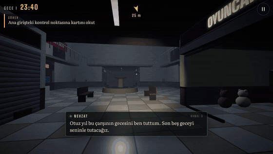</a>

### [Son Vardiya](https://github.com/Enskygr234/Son-Vardiya)
<code>3D</code> <code>Birinci şahıs</code> <code>Hikâye</code>

Yıkılmasına beş gün kalan bir AVM'de gece bekçisisin; telsizdeki eski bekçinin sırrını çöz. 5 gece, 5 hatıra, 3 son.

</td>
</tr>
<tr>
<td width="50%" valign="top">
<a href="https://enskygr234.github.io/mahalle/">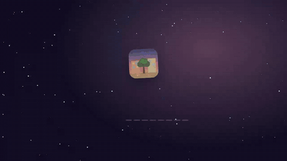</a>

### [Mahalle](https://github.com/Enskygr234/mahalle)
<code>Seçimli hikâye</code> <code>5 son</code>

1996 yazı, Akasya Sokağı: kararlarınla şekillenen bir mahalle hikâyesi.

</td>
<td width="50%" valign="top">
<a href="https://enskygr234.github.io/ayazle/">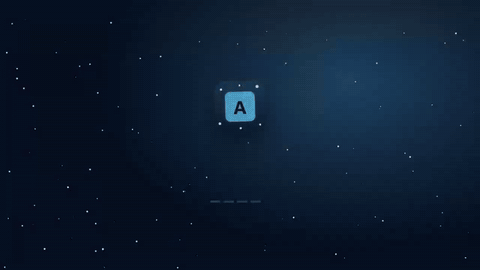</a>

### [Ayazle](https://github.com/Enskygr234/ayazle)
<code>Kelime oyunu</code> <code>Türkçe</code>

Gizli kelimeyi 6 hakta bul, sonunda anlamını öğren.

</td>
</tr>
<tr>
<td width="50%" valign="top">

### [Demon Academy](https://github.com/Enskygr234/demon-academy)
<code>Phaser 3</code> <code>Capacitor</code>

Piksel sanatlı, yandan kaydırmalı anime aksiyon RPG'si. Dört kahraman, beş bölüm, tek hedef: Void Gate'i kapatmak.
</td>
<td width="50%" valign="top">

### [Eclyra: Ayın Kuyusu](https://github.com/Enskygr234/eclyra)
<code>Electron</code> <code>Windows</code>

100 basamaklı Derinlik'e in, 10 Mühürdar'ı yen, Ay Tanrıçası'nı uyandır.

</td>
</tr>
<tr>
<td width="50%" valign="top">

### [LEDGER X](https://github.com/Enskygr234/LEDGER-X)
<code>Capacitor</code> <code>SQLite</code> <code>Android</code>

Fatura, teklif, müşteri ve ürün yönetimi; SQL editörü ve ER diyagramlı veritabanı stüdyosu. Çevrimdışı çalışır.
</td>
<td width="50%" valign="top">

### [Korku Modu](https://github.com/Enskygr234/korku-modu)
<code>Minecraft 1.21.1</code> <code>Fabric</code> <code>Java</code>

Türk efsanelerinden korku modu. Albastı yalnızca ona bakmadığında yaklaşır; Nazar Boncuğu taşıyorsan sana dokunamaz.

</td>
</tr>
<tr>
<td width="50%" valign="top">

### [Winterball](https://github.com/Enskygr234/Winterball)
<code>Android</code> <code>Canlı skor</code>

Canlı skorlar, kadrolar ve 14 ligin puan durumu.

</td>
<td width="50%" valign="top">

### [SysMonitor](https://github.com/Enskygr234/computer-maintenance)
<code>Electron</code> <code>Windows</code>

Bilgisayarın durumunu tek yerden izle, bakımını tek tıkla yap: performans, temizlik, donanım bilgisi.

</td>
</tr>
<tr>
<td width="50%" valign="top">

### [Oyuncu Merkezi](https://github.com/Enskygr234/oyuncu-merkez)
<code>React</code> <code>Vite</code> <code>Capacitor</code>

Steam indirimleri, hedef fiyata inince bildirim veren istek listesi ve Minecraft sunucu durumu.

</td>
<td width="50%" valign="top">

### [Türkçe API](https://github.com/Enskygr234/turkce-api)
<code>API</code> <code>Açık veri</code>

Sayıyı yazıya çevirme, il plaka kodları, resmi tatiller ve atasözleri.

</td>
</tr>
</table>

<b>Diğer oynanış önizlemeleri</b>

 

<table>
<tr>
<td width="50%" valign="top">
<a href="https://enskygr234.github.io/ensdewloper.github.io/ayaz-feneri/">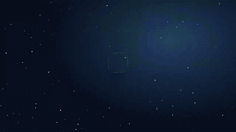</a>

**Ayaz Ata'nın Feneri** — Hikâyeli platform oyunu: Karakoncolos'tan yıldızları geri al. 
[APK](https://github.com/Enskygr234/winter-browser-releases/releases/download/wd-ensdewloper/AyazFeneri.apk) · [Oyna](https://enskygr234.github.io/ensdewloper.github.io/ayaz-feneri/)
</td>
<td width="50%" valign="top">
<a href="https://enskygr234.github.io/?q=GolHaber">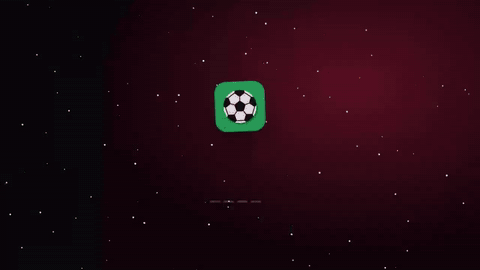</a>

**GolHaber** — Canlı skorlar, gol bildirimleri ve transfer haberleri. 
[APK](https://github.com/Enskygr234/winter-browser-releases/releases/download/wd-golhaber/GolHaber.apk)
</td>
</tr>
<tr>
<td width="50%" valign="top">
<a href="https://enskygr234.github.io/Winterball/">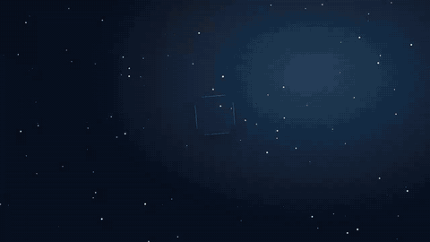</a>

**Winterball** — Canlı skorlar ve puan durumu.
</td>
<td width="50%" valign="top">
<a href="https://enskygr234.github.io/?q=Son%20K%C4%B1%C5%9F">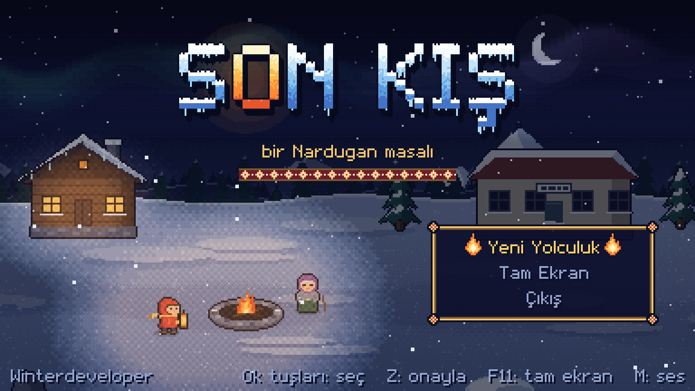</a>

**Son Kış** — Bir Nardugan masalı: masal ruhlarını ısıt ya da yak. 
[Windows için indir](https://github.com/Enskygr234/winter-browser-releases/releases/tag/wd-son-kis)
</td>
</tr>
</table>

<b>Tüm projeler</b>

 

**Oyunlar**

| Proje | Açıklama |
|---|---|
| [Son Vardiya](https://github.com/Enskygr234/Son-Vardiya) | Terk edilmiş AVM'de 3D gece bekçisi hikâyesi |
| [Son Tren](https://github.com/Enskygr234/Son-Tren) | Gece treninde hafızasız uyan, boş biletin sırrını çöz · [oyna](https://enskygr234.github.io/Son-Tren/) |
| [Karanlık Ev](https://github.com/Enskygr234/karanlik-ev) | Fenerle 3 anahtarı bul, hayaletten kaç: 3D korku |
| [Demon Academy](https://github.com/Enskygr234/demon-academy) | Piksel sanatlı anime aksiyon RPG'si |
| [Eclyra](https://github.com/Enskygr234/eclyra) | 100 katlı zindanda Ay Tanrıçası'nı uyandır |
| [Mahalle](https://github.com/Enskygr234/mahalle) | 1996 yazında geçen seçimli hikâye · [oyna](https://enskygr234.github.io/mahalle/) |
| [Kar Çarkı](https://github.com/Enskygr234/Kar-ark-) | 999.999.999 seviyeli Türkçe harf çarkı · [oyna](https://enskygr234.github.io/Kar-ark-/) |
| [Ayazle](https://github.com/Enskygr234/ayazle) | 6 hakta Türkçe kelime bul · [oyna](https://enskygr234.github.io/ayazle/) |
| [Buz Kırıcı](https://github.com/Enskygr234/buz-kirici) | Kartopuyla buz bloklarını kır: 8 bölümlük tuğla kırma |
| [Kar Birleştir](https://github.com/Enskygr234/kar-birlestir) | 2048 tarzı: kar tanesinden Ayaz Ata'ya |
| [Kızak](https://github.com/Enskygr234/kizak) | Ağaçlara çarpmadan sonsuz kızak |
| [XOX](https://github.com/Enskygr234/xox-oyunu) | Minimax'lı yenilmez bilgisayara karşı XOX |
| [Ayaz Ata'nın Feneri](https://enskygr234.github.io/ensdewloper.github.io/ayaz-feneri/) · [Son Kış](https://enskygr234.github.io/?q=Son%20K%C4%B1%C5%9F) · [Kayıp Fener](https://enskygr234.github.io/?q=Kay%C4%B1p%20Fener) | Platform ve masal oyunları |
| [Korku Modu](https://github.com/Enskygr234/korku-modu) | Minecraft için Türk efsaneleri korku modu |

**Android uygulamaları**

| Proje | Açıklama |
|---|---|
| [LEDGER X](https://github.com/Enskygr234/LEDGER-X) | İşletme yönetimi ve görsel veritabanı stüdyosu |
| [Mont Al](https://github.com/Enskygr234/mont-al) | Havaya bakıp ne giyeceğini söyler · [site](https://enskygr234.github.io/mont-al/) |
| [Oyuncu Merkezi](https://github.com/Enskygr234/oyuncu-merkez) | Steam indirimleri ve Minecraft sunucu durumu |
| [İndirim Avcısı](https://github.com/Enskygr234/indirim-avcisi) | Güvenilir mağazalardaki indirimleri 30 dakikada bir toplar |
| [Winterball](https://github.com/Enskygr234/Winterball) · [GolHaber](https://github.com/Enskygr234/golhaber) | Canlı skor, puan durumu, gol bildirimi |
| [Demir Fitness](https://github.com/Enskygr234/Winter-gym) · [FITTRACK](https://github.com/Enskygr234/FITTRACK) | Antrenman ve beslenme takibi |

**Windows araçları**

| Proje | Açıklama |
|---|---|
| [SysMonitor](https://github.com/Enskygr234/computer-maintenance) | Bilgisayar durumu ve tek tık bakım |
| [SA Garage](https://github.com/Enskygr234/sa-garage) | San Andreas launcher ve mod yöneticisi |
| [PC Cep Asistanı](https://github.com/Enskygr234/pc-cep-asistani) | Kurulumsuz sistem bilgisi ve tanılama |
| [Winter Browser](https://github.com/Enskygr234/winter-browser-releases) | Fütüristik masaüstü tarayıcı |
| [Buz Arşiv](https://enskygr234.github.io/?q=Buz%20Ar%C5%9Fiv) · [Ayaz Launcher](https://enskygr234.github.io/?q=Ayaz%20Launcher) · [Masaüstü Kar](https://enskygr234.github.io/?q=Masa%C3%BCst%C3%BC%20Kar) · [Klavye Ayazı](https://enskygr234.github.io/?q=Klavye%20Ayaz%C4%B1) | Küçük kış temalı masaüstü araçları |
| [Hazır .exe dosyaları](https://github.com/Enskygr234/indirmeler) | Windows uygulamalarımın indirmeleri |

**Web, API ve botlar**

| Proje | Açıklama |
|---|---|
| [Türkçe API](https://github.com/Enskygr234/turkce-api) | Sayıyı yazıya çevirme, il plaka kodları, resmi tatiller, atasözleri · [canlı](https://enskygr234.github.io/turkce-api/) |
| [Nöbetçi Eczane](https://github.com/Enskygr234/Nobet-ecza) | 81 ilde nöbetçi eczaneler, günde 2 kez güncellenir |
| [WinterM-himmat](https://github.com/Enskygr234/WinterM-himmat) | Python ile Telegram botu |
| [kar.js](https://github.com/Enskygr234/kar-js) | Sitene tek satırla kar yağdır |
| [Buz Şifre](https://github.com/Enskygr234/buz-sifre) · [Şifre Üretici](https://github.com/Enskygr234/sifre-uretici) | Akılda kalan ama kırılması zor şifreler |
| [Wintercle](https://github.com/Enskygr234/wintercle) | Kar yağışı altında odak zamanlayıcısı |
| [Piksel Ayaz](https://github.com/Enskygr234/piksel-ayaz) | Tarayıcıda piksel sanatı çiz |
| [Kar Tanesi](https://github.com/Enskygr234/kar-tanesi) | Adını yaz, sana özel SVG kar tanesi çıksın |
| [Nardugan](https://github.com/Enskygr234/nardugan) | Kış gündönümüne astronomik geri sayım |
| [Görev Listesi](https://github.com/Enskygr234/gorev-listesi) · [Harcama Takip](https://github.com/Enskygr234/harcama-takip) · [Pomodoro](https://github.com/Enskygr234/pomodoro-zamanlayici) | Tarayıcıda çalışan küçük araçlar |

## Son Yayınlar

<!-- YAYIN:BASLA -->
| Yayın | Tarih |
|---|---|
| [**Winterball**](https://github.com/Enskygr234/winter-browser-releases/releases/tag/wd-winterball) | 23 Ekim 2026 |
| [**Demir Fitness**](https://github.com/Enskygr234/winter-browser-releases/releases/tag/wd-winter-gym) | 23 Ekim 2026 |
| [**Son Vardiya**](https://github.com/Enskygr234/winter-browser-releases/releases/tag/wd-son-vardiya) | 23 Ekim 2026 |
| [**Son Tren**](https://github.com/Enskygr234/winter-browser-releases/releases/tag/wd-son-tren) | 23 Ekim 2026 |
| [**Son Kış**](https://github.com/Enskygr234/winter-browser-releases/releases/tag/wd-son-kis) | 23 Ekim 2026 |

Hepsi ve daha fazlası: [enskygr234.github.io](https://enskygr234.github.io/)
<!-- YAYIN:BITIS -->

## İletişim

<!--
  Sosyal medya hesaplarını eklemek için aşağıdaki satırların başındaki ve sonundaki yorum işaretlerini kaldırıp
  KULLANICI_ADI kısmını kendi kullanıcı adınla değiştir:

-->

Açık repolarımın hepsi <a href="LICENSE">MIT lisansı</a> ile paylaşılıyor: lisans ve telif notunu koruduğun sürece kullanabilir, değiştirebilir, dağıtabilirsin.

<!-- KIS:BASLA -->

Nardugan'a (kış gündönümü) <b>50 gün</b> kaldı &nbsp;<code>▰▰▰▰▰▰▰▰▰▰▰▰▰▰▰▰▰▱▱▱</code> Her gün kendiliğinden güncellenir · son: 1 Kasım 2026

<!-- KIS:BITIS -->
