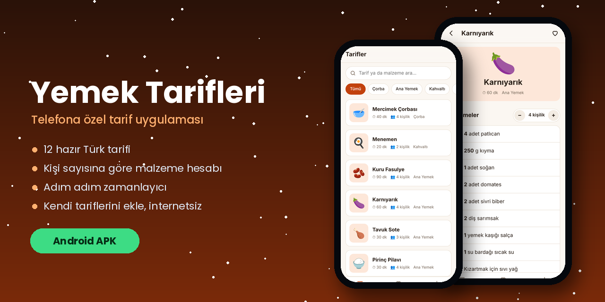

**Kışı seven bir geliştirici. Oyunlar, telefon uygulamaları, küçük Windows araçları ve kar yağan web sayfaları yapıyorum.**

<!-- KIS:BASLA -->

🌅 Nardugan'a (kış gündönümü) **68 gün** kaldı &nbsp; `❄❄❄❄❄❄❄❄❄❄❄❄❄❄❄❄····`

Her gün kendiliğinden güncellenir · son: 14 Ekim 2026

<!-- KIS:BITIS -->

  <picture>
    <source media="(prefers-color-scheme: dark)" srcset="dist/kar-koyu.svg">
    
  </picture>

## 🔥 Öne çıkanlar

<table>
<tr>
<td width="50%" valign="top">

**🏮 Ayaz Ata'nın Feneri** · *yeni* 
Hikâyeli 2D platform oyunu. Karakoncolos'un çaldığı üç yıldız parçasını topla, en uzun gece bitsin. 
[⬇ APK](https://github.com/Enskygr234/ensdewloper.github.io/releases/download/ayaz-feneri/AyazFeneri.apk) · [▶ Tarayıcıda oyna](https://enskygr234.github.io/ensdewloper.github.io/ayaz-feneri/)
</td>
<td width="50%" valign="top">

**❄️ Son Kış** 
Bir Nardugan masalı. Karakoncolos, Şahmeran, Tepegöz ve Ayaz Ata'yla karşılaş; onları ısıt ya da yak. 
[⬇ Windows için indir](https://github.com/Enskygr234/son-kis/releases/latest) · [Kaynak kod](https://github.com/Enskygr234/son-kis)
</td>
</tr>
<tr>
<td width="50%" valign="top">

**⚽ Winterball** · *yeni* 
Canlı skor uygulaması: goller, kartlar, kadrolar, istatistikler ve 14 ligin puan durumu. 
[⬇ APK](https://github.com/Enskygr234/Winterball/releases/download/son-surum/Winterball.apk) · [▶ Tarayıcıda aç](https://enskygr234.github.io/Winterball/) · [Kaynak kod](https://github.com/Enskygr234/Winterball)
</td>
<td width="50%" valign="top">

**🍲 Yemek Tarifleri** · *yeni* 
12 Türk tarifi, porsiyon hesabı, adım zamanlayıcısı ve kendi tariflerin. İnternetsiz çalışır. 
[⬇ APK](https://github.com/Enskygr234/ensdewloper.github.io/releases/latest) · [Tarayıcıda aç](https://enskygr234.github.io/ensdewloper.github.io/tarifler/)
</td>
</tr>
</table>

## 🧰 Bütün projeler

**📱 Telefon**

| Proje | Ne yapar | |
|---|---|---|
| 🔤 [**Ayazle**](https://github.com/Enskygr234/ayazle) · *yeni* | Türkçe kelime oyunu: her gün yeni kelime, süreli mod, bulunca anlamını öğret | [oyna](https://enskygr234.github.io/ayazle/) |
| ⚽ [**Winterball**](https://github.com/Enskygr234/Winterball) | Canlı skorlar, maç olayları, kadrolar, puan durumları; favori takım gol uyarısı | [APK](https://github.com/Enskygr234/Winterball/releases/download/son-surum/Winterball.apk) · [web](https://enskygr234.github.io/Winterball/) |
| 🍲 [**Yemek Tarifleri**](https://github.com/Enskygr234/ensdewloper.github.io/tree/main/tarifler) | Porsiyon hesaplayan, zamanlayıcılı tarif uygulaması | [APK](https://github.com/Enskygr234/ensdewloper.github.io/releases/latest) |
| 🏮 [**Ayaz Ata'nın Feneri**](https://github.com/Enskygr234/ensdewloper.github.io/tree/main/ayaz-feneri) | 3 bölümlük hikâyeli platform oyunu, Karakoncolos ile kapışma | [APK](https://github.com/Enskygr234/ensdewloper.github.io/releases/download/ayaz-feneri/AyazFeneri.apk) |

**🎮 Oyunlar**

| Proje | Ne yapar | |
|---|---|---|
| ❄️ [**Son Kış**](https://github.com/Enskygr234/son-kis) | Türk ve Anadolu masallarından ruhlarla geçen bir macera oyunu (C#) | [indir](https://github.com/Enskygr234/son-kis/releases/latest) |
| 🛷 [**Kızak**](https://github.com/Enskygr234/kizak) | Sonsuz yokuş aşağı kızak oyunu; telefonda da oynanır | [oyna](https://enskygr234.github.io/kizak/) |
| 🎮 [**Tarayıcı oyunları**](https://github.com/Enskygr234/ensdewloper.github.io) | Yılan, Pong, Tic Tac Toe, Taş Kâğıt Makas, Eşleştirme | [oyna](https://enskygr234.github.io/ensdewloper.github.io/oyunlar.html) |

**🖥️ Windows**

| Proje | Ne yapar | |
|---|---|---|
| 🚀 [**Ayaz Launcher**](https://github.com/Enskygr234/Ayaz-launcher) · *yeni* | `Ctrl + Space` ile açılan 5 yuvalı, buzlu cam görünümlü hızlı başlatıcı | [indir](https://github.com/Enskygr234/Ayaz-launcher/releases/latest) |
| 🔒 [**Güvenlik Kilidi**](https://github.com/Enskygr234/GuvenlikKilidi) | PIN korumalı tam ekran kilit: hareket alarmı, telefona bildirim, saat ve hava durumu | |
| 🖥️ [**Masaüstü Kar**](https://github.com/Enskygr234/masaustu-kar) | Windows masaüstüne kar yağdırır, tıklamaları engellemez | [indir](https://github.com/Enskygr234/masaustu-kar/releases/latest) |
| 🌡️ [**ayaz**](https://github.com/Enskygr234/ayaz) | Terminalde hava durumu ve "kar ne zaman?" | [indir](https://github.com/Enskygr234/ayaz/releases/latest) |

**🌐 Web**

| Proje | Ne yapar | |
|---|---|---|
| 🌨️ [**kar.js**](https://github.com/Enskygr234/kar-js) | Web sayfana tek satırla kar yağdıran kütüphane | [demo](https://enskygr234.github.io/kar-js/) |
| ✳️ [**Kar Tanesi**](https://github.com/Enskygr234/kar-tanesi) | Adını yaz, sana özel kar tanesi üretsin | [aç](https://enskygr234.github.io/kar-tanesi/) |
| 🌅 [**Nardugan**](https://github.com/Enskygr234/nardugan) | Kış gündönümüne canlı geri sayım; anı astronomik olarak hesaplar | [aç](https://enskygr234.github.io/nardugan/) |

## 📦 Son yayınlar

<!-- YAYIN:BASLA -->
| Yayın | Depo | Tarih |
|---|---|---|
| [**Yemek Tarifleri (sürüm 3)**](https://github.com/Enskygr234/ensdewloper.github.io/releases/tag/tarifler-3) | [ensdewloper.github.io](https://github.com/Enskygr234/ensdewloper.github.io) | 13 Ekim 2026 |
| [**Winterball (son sürüm)**](https://github.com/Enskygr234/Winterball/releases/tag/son-surum) | [Winterball](https://github.com/Enskygr234/Winterball) | 13 Ekim 2026 |
| [**Ayaz Ata'nın Feneri (oyun)**](https://github.com/Enskygr234/ensdewloper.github.io/releases/tag/ayaz-feneri) | [ensdewloper.github.io](https://github.com/Enskygr234/ensdewloper.github.io) | 13 Ekim 2026 |
| [**Yemek Tarifleri (sürüm 2)**](https://github.com/Enskygr234/ensdewloper.github.io/releases/tag/tarifler-2) | [ensdewloper.github.io](https://github.com/Enskygr234/ensdewloper.github.io) | 13 Ekim 2026 |
| [**Masaüstü Kar v1.0**](https://github.com/Enskygr234/masaustu-kar/releases/tag/v1.0.0) | [masaustu-kar](https://github.com/Enskygr234/masaustu-kar) | 13 Ekim 2026 |
<!-- YAYIN:BITIS -->

## ✳️ Bugünün kar taneleri

## 🛠️ Kullandıklarım

*❄️ Kış gelir, kod yazılır. ❄️*

