**Oyunlar, Android uygulamaları, bir Minecraft modu ve küçük Windows araçları yapıyorum.** 
Çoğu Türk masallarından, kıştan ve Nardugan'dan ilham alıyor.

<!-- KIS:BASLA -->

🌅 Nardugan'a (kış gündönümü) **51 gün** kaldı &nbsp; `❄❄❄❄❄❄❄❄❄❄❄❄❄❄❄❄❄···`

Her gün kendiliğinden güncellenir · son: 31 Ekim 2026

<!-- KIS:BITIS -->

## 📊 Rakamlarla

<picture>
  <source media="(prefers-color-scheme: dark)" srcset="dist/istatistik-koyu.svg">
  
</picture>

Kendi GitHub Actions işimle her gece yeniden çiziliyor; dış servise bağlı değil, hiç kırılmaz.

## 🔥 Öne çıkanlar

<table>
<tr>
<td colspan="2" valign="top">

**🔦 Son Vardiya** &nbsp;3D · birinci şahıs hikâye oyunu 
Yıkılmasına beş gün kalan bir AVM'de gece bekçisisin; telsizdeki eski bekçinin sırrını çöz. 5 gece, 5 hatıra, 3 son. 
[⬇ APK](https://github.com/Enskygr234/winter-browser-releases/releases/download/wd-son-vardiya/SonVardiya.apk) · [▶ Oyna](https://enskygr234.github.io/ensdewloper.github.io/son-vardiya/) · [🎬 Tanıtım](https://enskygr234.github.io/ensdewloper.github.io/img/video/sonvardiya.mp4)
</td>
</tr>
<tr>
<td width="50%" valign="top">

**🏘️ Mahalle** 
1996 yazı, Akasya Sokağı: seçimli hikâye oyunu, 5 farklı son. 
[⬇ APK](https://github.com/Enskygr234/winter-browser-releases/releases/download/wd-mahalle/Mahalle.apk) · [⬇ Windows](https://github.com/Enskygr234/winter-browser-releases/releases/download/wd-mahalle/Mahalle-Windows.exe) · [▶ Oyna](https://enskygr234.github.io/mahalle/)
</td>
<td width="50%" valign="top">

**🔤 Ayazle** 
Türkçe kelime oyunu: gizli kelimeyi 6 hakta bul, anlamını öğren. 
[⬇ APK](https://github.com/Enskygr234/winter-browser-releases/releases/download/wd-ayazle/Ayazle.apk) · [▶ Oyna](https://enskygr234.github.io/ayazle/)
</td>
</tr>
<tr>
<td width="50%" valign="top">

**⚽ Winterball** 
Canlı skorlar, kadrolar ve 14 ligin puan durumu. 
[⬇ APK](https://github.com/Enskygr234/winter-browser-releases/releases/download/wd-winterball/Winterball.apk) · [▶ Aç](https://enskygr234.github.io/Winterball/)
</td>
<td width="50%" valign="top">

**🏮 Ayaz Ata'nın Feneri** 
Hikâyeli platform oyunu: Karakoncolos'tan yıldızları geri al. 
[⬇ APK](https://github.com/Enskygr234/winter-browser-releases/releases/download/wd-ensdewloper/AyazFeneri.apk) · [▶ Oyna](https://enskygr234.github.io/ensdewloper.github.io/ayaz-feneri/)
</td>
</tr>
<tr>
<td width="50%" valign="top">

**⚽ GolHaber** 
Canlı skorlar, gol bildirimleri ve transfer haberleri. 
[⬇ APK](https://github.com/Enskygr234/winter-browser-releases/releases/download/wd-golhaber/GolHaber.apk)
</td>
<td width="50%" valign="top">

**❄️ Son Kış** 
Bir Nardugan masalı: masal ruhlarını ısıt ya da yak. 
[⬇ Windows için indir](https://github.com/Enskygr234/winter-browser-releases/releases/tag/wd-son-kis)
</td>
</tr>
</table>

## 🆕 Son eklenenler

<table>
<tr>
<td width="33%" valign="top">

**⚔️ [Demon Academy](https://github.com/Enskygr234/demon-academy)** 
Phaser 3 · Capacitor

Piksel sanatlı, yandan kaydırmalı anime aksiyon RPG'si. Dört kahraman, beş bölüm, tek hedef: Void Gate'i kapatmak.
</td>
<td width="33%" valign="top">

**🌙 [Eclyra: Ayın Kuyusu](https://github.com/Enskygr234/eclyra)** 
Electron · Windows

Kiri Köyü'nün altındaki 100 basamaklı Derinlik'e in, 10 Mühürdar'ı yen, Ay Tanrıçası'nı uyandır.

</td>
<td width="33%" valign="top">

**📒 [LEDGER X](https://github.com/Enskygr234/LEDGER-X)** 
Capacitor · SQLite · Android

Fatura, teklif, müşteri ve ürün yönetimi; içinde SQL editörü ve ER diyagramlı veritabanı stüdyosu. Çevrimdışı çalışır.
</td>
</tr>
<tr>
<td width="33%" valign="top">

**🖥️ [SysMonitor](https://github.com/Enskygr234/computer-maintenance)** 
Electron · Windows

Bilgisayarın durumunu tek yerden izle, bakımını tek tıkla yap: performans, temizlik, donanım bilgisi.

</td>
<td width="33%" valign="top">

**🚗 [SA Garage](https://github.com/Enskygr234/sa-garage)** 
Electron · Windows

San Andreas için kişisel launcher: tek tıkla oyna, araç modlarını kur, kayıtlarını yedekle.

</td>
<td width="33%" valign="top">

**🏋️ [FITTRACK](https://github.com/Enskygr234/FITTRACK)** 
HTML · CSS · JavaScript

Çevrimdışı fitness takibi: kendi programın, 873 egzersizlik kütüphane, beslenme, protein ve su takibi.
</td>
</tr>
<tr>
<td width="33%" valign="top">

**👁️ [Korku Modu](https://github.com/Enskygr234/korku-modu)** 
Minecraft 1.21.1 · Fabric · Java

Türk efsanelerinden korku modu. Albastı sadece ona bakmadığında yaklaşır; Nazar Boncuğu taşıyorsan sana dokunamaz.

</td>
<td width="33%" valign="top">

**🎮 [Oyuncu Merkezi](https://github.com/Enskygr234/oyuncu-merkez)** 
React · Vite · Capacitor

Steam indirimleri, hedef fiyata inince bildirim veren istek listesi ve Minecraft sunucu durumu.

</td>
<td width="33%" valign="top">

**🏷️ [İndirim Avcısı](https://github.com/Enskygr234/indirim-avcisi)** 
Kotlin · Jetpack Compose · Python

Güvenilir mağazalardaki indirimleri 30 dakikada bir toplar; oranına ve kategoriye göre süzersin.

</td>
</tr>
</table>

## 🧰 Bütün projelerim

<b>🎮 Oyunlar</b>

 

| Proje | Ne? |
|---|---|
| [Son Vardiya](https://github.com/Enskygr234/Son-Vardiya) | Terk edilmiş AVM'de 3D gece bekçisi hikâyesi |
| [Son Tren](https://github.com/Enskygr234/Son-Tren) | Gece treninde hafızasız uyan, boş biletin sırrını çöz · [▶ oyna](https://enskygr234.github.io/Son-Tren/) |
| [Karanlık Ev](https://github.com/Enskygr234/karanlik-ev) | Fenerle 3 anahtarı bul, hayaletten kaç: 3D korku |
| [Demon Academy](https://github.com/Enskygr234/demon-academy) | Piksel sanatlı anime aksiyon RPG'si |
| [Eclyra](https://github.com/Enskygr234/eclyra) | 100 katlı zindanda Ay Tanrıçası'nı uyandır |
| [Mahalle](https://github.com/Enskygr234/mahalle) | 1996 yazında geçen seçimli hikâye · [▶ oyna](https://enskygr234.github.io/mahalle/) |
| [Kar Çarkı](https://github.com/Enskygr234/Kar-ark-) | 999.999.999 seviyeli Türkçe harf çarkı · [▶ oyna](https://enskygr234.github.io/Kar-ark-/) |
| [Ayazle](https://github.com/Enskygr234/ayazle) | 6 hakta Türkçe kelime bul · [▶ oyna](https://enskygr234.github.io/ayazle/) |
| [Buz Kırıcı](https://github.com/Enskygr234/buz-kirici) | Kartopuyla buz bloklarını kır: 8 bölümlük tuğla kırma |
| [Kar Birleştir](https://github.com/Enskygr234/kar-birlestir) | 2048 tarzı: kar tanesinden Ayaz Ata'ya |
| [Kızak](https://github.com/Enskygr234/kizak) | Ağaçlara çarpmadan sonsuz kızak |
| [XOX](https://github.com/Enskygr234/xox-oyunu) | Minimax'lı yenilmez bilgisayara karşı XOX |
| [Ayaz Ata'nın Feneri](https://enskygr234.github.io/ensdewloper.github.io/ayaz-feneri/) · [Son Kış](https://enskygr234.github.io/?q=Son%20K%C4%B1%C5%9F) · [Kayıp Fener](https://enskygr234.github.io/?q=Kay%C4%B1p%20Fener) | Platform ve masal oyunları |
| [Korku Modu](https://github.com/Enskygr234/korku-modu) | 🧱 Minecraft için Türk efsaneleri korku modu |

<b>📱 Android uygulamaları</b>

 

| Proje | Ne? |
|---|---|
| [LEDGER X](https://github.com/Enskygr234/LEDGER-X) | İşletme yönetimi ve görsel veritabanı stüdyosu |
| [Mont Al](https://github.com/Enskygr234/mont-al) | Havaya bakıp ne giyeceğini söyler · [site](https://enskygr234.github.io/mont-al/) |
| [Oyuncu Merkezi](https://github.com/Enskygr234/oyuncu-merkez) | Steam indirimleri ve Minecraft sunucu durumu |
| [İndirim Avcısı](https://github.com/Enskygr234/indirim-avcisi) | Mağaza indirimlerini toplar |
| [Winterball](https://github.com/Enskygr234/Winterball) · [GolHaber](https://github.com/Enskygr234/golhaber) | Canlı skor, puan durumu, gol bildirimi |
| [Demir Fitness](https://github.com/Enskygr234/Winter-gym) · [FITTRACK](https://github.com/Enskygr234/FITTRACK) | Antrenman ve beslenme takibi |

<b>🖥️ Windows araçları</b>

 

| Proje | Ne? |
|---|---|
| [SysMonitor](https://github.com/Enskygr234/computer-maintenance) | Bilgisayar durumu ve tek tık bakım |
| [SA Garage](https://github.com/Enskygr234/sa-garage) | San Andreas launcher ve mod yöneticisi |
| [PC Cep Asistanı](https://github.com/Enskygr234/pc-cep-asistani) | Kurulumsuz sistem bilgisi ve tanılama |
| [Winter Browser](https://github.com/Enskygr234/winter-browser-releases) | Fütüristik masaüstü tarayıcı |
| [Buz Arşiv](https://enskygr234.github.io/?q=Buz%20Ar%C5%9Fiv) · [Ayaz Launcher](https://enskygr234.github.io/?q=Ayaz%20Launcher) · [Masaüstü Kar](https://enskygr234.github.io/?q=Masa%C3%BCst%C3%BC%20Kar) · [Klavye Ayazı](https://enskygr234.github.io/?q=Klavye%20Ayaz%C4%B1) | Küçük kış temalı masaüstü araçları |
| [Hazır .exe dosyaları](https://github.com/Enskygr234/indirmeler) | Windows uygulamalarımın indirmeleri |

<b>🌐 Web, API ve botlar</b>

 

| Proje | Ne? |
|---|---|
| [Türkçe API](https://github.com/Enskygr234/turkce-api) | Sayıyı yazıya çevirme, il plaka kodları, resmi tatiller, atasözleri · [canlı](https://enskygr234.github.io/turkce-api/) |
| [Nöbetçi Eczane](https://github.com/Enskygr234/Nobet-ecza) | 81 ilde nöbetçi eczaneler, günde 2 kez güncellenir |
| [WinterM-himmat](https://github.com/Enskygr234/WinterM-himmat) | Python ile Telegram botu |
| [kar.js](https://github.com/Enskygr234/kar-js) | Sitene tek satırla kar yağdır |
| [Buz Şifre](https://github.com/Enskygr234/buz-sifre) · [Şifre Üretici](https://github.com/Enskygr234/sifre-uretici) | Akılda kalan ama kırılması zor şifreler |
| [Wintercle](https://github.com/Enskygr234/wintercle) | Kar yağışı altında odak zamanlayıcısı |
| [Piksel Ayaz](https://github.com/Enskygr234/piksel-ayaz) | Tarayıcıda piksel sanatı çiz |
| [Kar Tanesi](https://github.com/Enskygr234/kar-tanesi) | Adını yaz, sana özel SVG kar tanesi çıksın |
| [Nardugan](https://github.com/Enskygr234/nardugan) | Kış gündönümüne astronomik geri sayım |
| [Görev Listesi](https://github.com/Enskygr234/gorev-listesi) · [Harcama Takip](https://github.com/Enskygr234/harcama-takip) · [Pomodoro](https://github.com/Enskygr234/pomodoro-zamanlayici) | Tarayıcıda çalışan küçük araçlar |

Açıklamalar, tanıtım videoları ve indirme butonları için: **[sitem](https://enskygr234.github.io/)**

## 📦 Son yayınlar

<!-- YAYIN:BASLA -->
| Yayın | Tarih |
|---|---|
| [**Winterball**](https://github.com/Enskygr234/winter-browser-releases/releases/tag/wd-winterball) | 23 Ekim 2026 |
| [**Demir Fitness**](https://github.com/Enskygr234/winter-browser-releases/releases/tag/wd-winter-gym) | 23 Ekim 2026 |
| [**Son Vardiya**](https://github.com/Enskygr234/winter-browser-releases/releases/tag/wd-son-vardiya) | 23 Ekim 2026 |
| [**Son Tren**](https://github.com/Enskygr234/winter-browser-releases/releases/tag/wd-son-tren) | 23 Ekim 2026 |
| [**Son Kış**](https://github.com/Enskygr234/winter-browser-releases/releases/tag/wd-son-kis) | 23 Ekim 2026 |

Hepsi ve daha fazlası: [enskygr234.github.io](https://enskygr234.github.io/)
<!-- YAYIN:BITIS -->

## 🛠️ Kullandıklarım

  

## ❄️ Kar yağan katkı grafiğim

<picture>
  <source media="(prefers-color-scheme: dark)" srcset="dist/kar-koyu.svg">
  
</picture>

## 📜 Lisans

Açık repolarımın hepsi **[MIT lisansı](LICENSE)** ile paylaşılıyor: kodu kullanabilir, değiştirebilir, kendi projende dağıtabilirsin; tek şart lisans ve telif notunu korumak. Her reponun kendi `LICENSE` dosyası var.

---

❄️ Kış gelir, kod yazılır.

